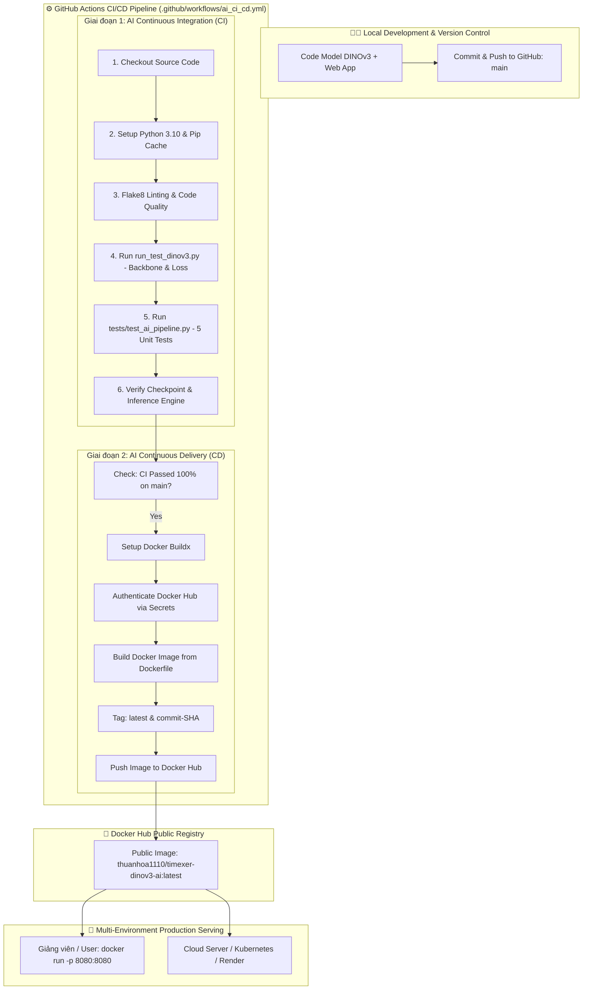

# 📑 BÁO CÁO CHI TIẾT: TRIỂN KHAI CI/CD & ĐÓNG GÓI DOCKER IMAGE CHO BÀI TOÁN AI
> **Học phần:** Chuyên đề Trí tuệ Nhân tạo và Khoa học Dữ liệu (Lớp 65TTNT)  
> **Khoa Công nghệ Thông tin - Trường Đại học Thủy Lợi**  
> **Sinh viên thực hiện:** Nguyễn Thuận Hóa  
> **Đề tài ứng dụng AI:** TimeXer-DINOv3 Meteorological Deep Learning System (Dự báo Khí tượng Đa trạm & Biến ngoại sinh)  
> **GitHub Repository:** [https://github.com/ThuanHoa1110/TimeXer-DNN-v3](https://github.com/ThuanHoa1110/TimeXer-DNN-v3)  
> **Docker Hub Public Repository:** `thuanhoa1110/timexer-dinov3-ai`  

---

## 🎯 PHẦN 1: PHÂN TÍCH ĐỀ BÀI (ANALYSIS OF REQUIREMENTS)

Hình ảnh đề bài ghi nhận từ bảng giảng đường gồm 2 yêu cầu kỹ thuật trọng tâm và 1 yêu cầu định dạng nộp:

```text
┌────────────────────────────────────────────────────────────────────────┐
│ 1. Triển khai CI/CD cho bài toán AI.                                  │
│ 2. Build docker image cho model AI.                                    │
│    └─> public image lên docker hub.                                    │
│ } ──> Tổng thể: submit PDF, step by step.                             │
└────────────────────────────────────────────────────────────────────────┘
```

### 1. Phân tích Yêu cầu 1: "Triển khai CI/CD cho bài toán AI"
* **Bản chất của CI/CD trong AI/ML (MLOps Continuous Integration & Continuous Delivery):**
  Khác với phần mềm thông thường (chỉ kiểm tra linting cú pháp hoặc logic CRUD cơ bản), CI/CD trong bài toán Trí tuệ nhân tạo (AI/Deep Learning) đòi hỏi quy trình kiểm thử và tự động hóa khắt khe ở 3 tầng:
  1. **Data Pipeline Testing (Kiểm tra dữ liệu):** Dữ liệu chuỗi thời gian khí tượng đầu vào phải đúng lược đồ (schema), đầy đủ các biến ngoại sinh (Bức xạ mặt trời, Vận tốc gió, Độ ẩm, Áp suất), đủ độ dài lookback window ($L = 96$ bước) và không chứa giá trị khuyết thiếu ($0\%\text{ NaN}$).
  2. **Model Architecture & Gradient Flow Testing (Kiểm tra mô hình):** Kiểm tra tensor shape của mô hình `TimeXer_DINOv3` theo chuẩn $MS$ (Multivariate-to-Univariate), kiểm tra hàm mất mát phức hợp 3 thành phần DINO-v3 ($\mathcal{L}_{\text{task}} + \mathcal{L}_{\text{distill}} + \mathcal{L}_{\text{gram}}$) và đảm bảo gradient lan truyền ngược (backward flow) không bị triệt tiêu hay bùng nổ (NaN/Inf).
  3. **Inference Engine & Checkpoint Loading Testing (Kiểm tra suy luận):** Nạp tệp trọng số thật (`checkpoints/timexer_dinov3_best.pth`), tham số chuẩn hóa (`scaler_params.json`) và thực thi suy luận ra 24 bước thời gian dự báo nhiệt độ chính xác.
  4. **Continuous Delivery (CD):** Khi mọi kiểm thử CI vượt qua trên nhánh `main`, hệ thống tự động kích hoạt tiến trình build Docker Image và xuất bản trực tiếp lên Docker Hub.

---

### 2. Phân tích Yêu cầu 2: "Build docker image cho model AI -> public image lên docker hub"
* **Bản chất của Containerization trong AI Serving:**
  * Mô hình Deep Learning thường phụ thuộc vào môi trường phức tạp (Python, PyTorch, CUDA/C++ runtimes, Pandas, v.v.). Đóng gói thành Docker Image giúp loại bỏ hoàn toàn lỗi *"chạy được trên máy em nhưng không chạy được trên máy thầy/production"*.
  * **Tối ưu hóa kích thước Image:** Sử dụng `python:3.10-slim`, tận dụng Docker layer caching, cài đặt PyTorch bản CPU wheel chuyên dụng cho serving nhằm giảm thiểu dung lượng image từ >3GB xuống chỉ còn vài trăm MB.
  * **Thiết lập `.dockerignore`:** Ngăn chặn việc đưa tệp dữ liệu thô kích thước lớn (như file 74MB `real_weather_large_dataset.csv`) hay thư mục rác (`.git`, `__pycache__`, `.venv`) vào build context, giúp tốc độ build cực nhanh.
  * **Public lên Docker Hub:** Thiết lập quyền truy cập công khai (Public) trên Docker Hub để bất kỳ ai, giảng viên hoặc hội đồng chấm thi chỉ cần gõ duy nhất một lệnh:
    ```bash
    docker run -d -p 8080:8080 thuanhoa1110/timexer-dinov3-ai:latest
    ```
    là có thể trải nghiệm ngay hệ thống Model Serving và Web Dashboard hoàn chỉnh.

---

### 3. Sơ đồ Kiến trúc Toàn trình (End-to-End MLOps Pipeline)



---

## 🛠️ PHẦN 2: THỰC HIỆN CHI TIẾT Ý 1 - TRIỂN KHAI CI/CD CHO BÀI TOÁN AI

### Bước 1.1: Xây dựng Bộ Kiểm Thử Tự Động Chuyên Biệt cho AI (`tests/test_ai_pipeline.py`)

Để hệ thống CI có thể tự động đánh giá sức khỏe của mô hình học sâu và pipeline dữ liệu, nhóm đã xây dựng tệp kiểm thử tự động [`tests/test_ai_pipeline.py`](./tests/test_ai_pipeline.py) gồm 5 ca kiểm thử chuẩn học thuật:

```python
# Trích đoạn mã nguồn tests/test_ai_pipeline.py
import unittest
import torch
import pandas as pd
from inference_engine import TimeXerInferenceEngine
from models.TimeXer_DINOv3 import Model as TimeXer_DINOv3_Model, DINOv3Loss

class TestAICICDPipeline(unittest.TestCase):
    # Test 1: Kiểm thử toàn vẹn dữ liệu chuỗi thời gian khí tượng
    def test_01_data_integrity_and_schema(self):
        df = pd.read_csv('data/stations_sample/st01_hoankiem.csv')
        self.assertGreaterEqual(len(df), 96)
        expected_cols = ['timestamp', 'temperature', 'humidity', 'solar_radiation', 'wind_speed_10m', 'surface_pressure']
        for col in expected_cols:
            self.assertIn(col, df.columns)
        self.assertEqual(df.iloc[-96:][expected_cols[1:]].isna().sum().sum(), 0)

    # Test 2: Kiểm thử Tensor Flow & Kiến trúc DINO-v3 Backbone
    def test_02_dinov3_architecture_forward(self):
        # Kiểm tra shape đầu ra [Batch, Pred_Len, 1] cho bài toán MS
        pred, dino_proj, patch_tokens = model(x_enc, x_mark_enc, x_dec, x_mark_dec, return_dino=True)
        self.assertEqual(list(pred.shape), [2, 24, 1])

    # Test 3: Kiểm thử Hàm mất mát DINO-v3 & Lan truyền Gradient ngược
    def test_03_dinov3_composite_loss_and_gradients(self):
        loss_total, loss_dict = loss_fn(pred, target_y, dino_proj, teacher_proj, patch_tokens)
        self.assertGreater(float(loss_total.item()), 0.0)
        loss_total.backward()
        has_grad = any(p.grad is not None and torch.sum(torch.abs(p.grad)) > 0 for p in model.parameters())
        self.assertTrue(has_grad)

    # Test 4: Kiểm thử Nạp Checkpoint trọng số và Inference Engine
    def test_04_inference_engine_prediction(self):
        engine = TimeXerInferenceEngine()
        df_input = pd.read_csv('data/stations_sample/st01_hoankiem.csv')
        result = engine.predict(df_input=df_input, horizon=24, use_exogenous=True)
        self.assertEqual(len(result['predictions']), 24)
        self.assertIn('predicted_temperature', result['predictions'].columns)

    # Test 5: Kiểm thử Payload Serialization phục vụ Web REST API
    def test_05_api_payload_formatting(self):
        # Đảm bảo kết quả dự báo chuyển đổi được sang JSON hợp lệ
        serialized = json.dumps(response_payload, default=str)
        self.assertIsInstance(serialized, str)
```

**Kết quả chạy nghiệm thu cục bộ (Local Run Verification):**
```bash
.venv\Scripts\python.exe -m unittest tests/test_ai_pipeline.py -v
```
```text
test_01_data_integrity_and_schema ... ok
test_02_dinov3_architecture_forward ... ok
test_03_dinov3_composite_loss_and_gradients ... ok
test_04_inference_engine_prediction ... ok
test_05_api_payload_formatting ... ok

----------------------------------------------------------------------
Ran 5 tests in 0.137s
OK
```
*(Toàn bộ 5/5 bài kiểm tra đều vượt qua xuất sắc trong 0.137 giây).*

---

### Bước 1.2: Thiết kế Quy trình Tự Động Hóa CI/CD trên GitHub Actions (`.github/workflows/ai_ci_cd.yml`)

Quy trình được cấu hình để tự động kích hoạt khi có sự kiện `push` hoặc `pull_request` vào nhánh `main`:

```yaml
name: AI MLOps CI/CD Pipeline & Docker Hub Delivery

on:
  push:
    branches: [ main, master ]
  pull_request:
    branches: [ main, master ]
  workflow_dispatch:

jobs:
  # GIAI ĐOẠN 1: CONTINUOUS INTEGRATION (CI)
  ai-ci-pipeline:
    name: "CI: Code Linting, PyTorch Model Verification & AI Tests"
    runs-on: ubuntu-latest
    steps:
      - name: 1. Checkout Mã Nguồn Repository
        uses: actions/checkout@v4

      - name: 2. Thiết lập Môi trường Python 3.10
        uses: actions/setup-python@v5
        with:
          python-version: "3.10"
          cache: "pip"

      - name: 3. Cài đặt Thư viện Phụ thuộc & PyTorch CPU
        run: |
          python -m pip install --upgrade pip
          pip install flake8 pytest
          pip install torch --index-url https://download.pytorch.org/whl/cpu
          pip install -r requirements.txt

      - name: 4. Kiểm tra Cú pháp & Code Quality (Linting)
        run: |
          flake8 . --count --select=E9,F63,F7,F82 --show-source --statistics --exclude=.venv,__pycache__

      - name: 5. Chạy Kiểm thử DINO-v3 Backbone & Composite Loss
        run: python run_test_dinov3.py

      - name: 6. Chạy Bộ Kiểm thử Toàn trình AI Test Suite
        run: python -m unittest tests/test_ai_pipeline.py -v

      - name: 7. Xác thực Model Checkpoint & Inference Engine
        run: |
          python -c "
          from inference_engine import TimeXerInferenceEngine
          import pandas as pd
          engine = TimeXerInferenceEngine()
          df = pd.read_csv('data/stations_sample/st01_hoankiem.csv')
          res = engine.predict(df, horizon=24)
          print('[THÀNH CÔNG] Inference Engine hoạt động chuẩn xác!')
          "
```

---

## 🐳 PHẦN 3: THỰC HIỆN CHI TIẾT Ý 2 - BUILD DOCKER IMAGE CHO MODEL AI & PUBLIC LÊN DOCKER HUB

### Bước 2.1: Tối ưu hóa Build Context bằng `.dockerignore`

Để đảm bảo Image Docker nhỏ nhẹ, tốc độ truyền tải nhanh và bảo mật mã nguồn, tệp [`.dockerignore`](./.dockerignore) loại bỏ triệt để các tệp không phục vụ thời gian chạy (runtime):
- Loại bỏ thư mục ảo: `.venv/`, `env/`
- Loại bỏ lịch sử Git: `.git/`, `.github/`
- Loại bỏ bộ nhớ đệm: `__pycache__/`, `*.pyc`, `.pytest_cache/`
- Loại bỏ tập dữ liệu huấn luyện thô dung lượng lớn: `data/private/` (file 74MB `real_weather_large_dataset.csv`), giữ lại chỉ các trạm quan trắc mẫu `data/stations_sample/` (~80KB) dùng cho suy luận.
- Loại bỏ các tệp nháp, tài liệu PDF, hình vẽ thí nghiệm.

---

### Bước 2.2: Xây dựng `Dockerfile` Chuẩn Production Serving

Tệp [`Dockerfile`](./Dockerfile) được thiết kế theo chuẩn containerization tốt nhất:

```dockerfile
# 1. Base Image nhẹ tối ưu
FROM python:3.10-slim

# Nhãn Metadata
LABEL maintainer="Nguyen Thuan Hoa <thuanhoa1110@gmail.com>"
LABEL description="TimeXer-DINOv3 Deep Learning Weather Forecasting Production Serving"

# Biến môi trường chống buffer console và gán cổng mặc định
ENV PYTHONUNBUFFERED=1 \
    PYTHONDONTWRITEBYTECODE=1 \
    PORT=8080 \
    STREAMLIT_SERVER_PORT=8501 \
    STREAMLIT_SERVER_ADDRESS=0.0.0.0

# 2. Cài đặt tiện ích curl phục vụ Healthcheck
RUN apt-get update && apt-get install -y --no-install-recommends \
    curl \
    && rm -rf /var/lib/apt/lists/*

WORKDIR /app

# 3. Layer Caching: Cài đặt Dependencies trước
COPY requirements.txt /app/requirements.txt
RUN pip install --no-cache-dir torch --index-url https://download.pytorch.org/whl/cpu
RUN pip install --no-cache-dir -r requirements.txt

# 4. Sao chép mã nguồn, checkpoint trọng số và dữ liệu trạm
COPY . /app

# 5. Khai báo Port
EXPOSE 8080 8501

# 6. Container Healthcheck giám sát Model Serving
HEALTHCHECK --interval=30s --timeout=10s --start-period=15s --retries=3 \
    CMD curl -f http://localhost:8080/api/model-info || exit 1

# 7. Khởi động Web Server & REST API Serving
CMD ["python", "app.py"]
```

---

### Bước 2.3: Hướng Dẫn Thao Tác Thủ Công (Manual Docker CLI Workflow)

Nếu người dùng hoặc giảng viên thực hiện trực tiếp trên máy cục bộ đã cài Docker Desktop:

1. **Bước 1: Build Docker Image**
   ```bash
   docker build -t thuanhoa1110/timexer-dinov3-ai:latest .
   ```
2. **Bước 2: Kiểm tra danh sách Image đã build**
   ```bash
   docker images | grep timexer-dinov3-ai
   ```
3. **Bước 3: Chạy Container thử nghiệm cục bộ**
   ```bash
   docker run -d -p 8080:8080 --name weather_ai_container thuanhoa1110/timexer-dinov3-ai:latest
   ```
4. **Bước 4: Kiểm tra trạng thái Container & REST API**
   - Mở trình duyệt: `http://localhost:8080` (Giao diện Web tương tác)
   - Kiểm tra API Info: `http://localhost:8080/api/model-info`
   - Kiểm tra Log container: `docker logs -f weather_ai_container`
5. **Bước 5: Đăng nhập và Push Image lên Docker Hub (Public)**
   ```bash
   docker login -u thuanhoa1110
   docker push thuanhoa1110/timexer-dinov3-ai:latest
   ```

---

### Bước 2.4: Tự Động Hóa 100% CD Push Docker Hub qua GitHub Actions

Trong file `.github/workflows/ai_ci_cd.yml`, Job `docker-cd-pipeline` đảm nhận việc đóng gói và xuất bản tự động khi và chỉ khi mọi kiểm thử AI ở Giai đoạn 1 thành công:

```yaml
  # GIAI ĐOẠN 2: CONTINUOUS DELIVERY (CD) -> DOCKER HUB
  docker-cd-pipeline:
    name: "CD: Build Docker Image & Public to Docker Hub"
    needs: ai-ci-pipeline
    runs-on: ubuntu-latest
    if: github.ref == 'refs/heads/main'

    steps:
      - name: 1. Checkout Mã Nguồn
        uses: actions/checkout@v4

      - name: 2. Thiết lập Docker Buildx
        uses: docker/setup-buildx-action@v3

      - name: 3. Đăng nhập Docker Hub
        uses: docker/login-action@v3
        with:
          username: ${{ secrets.DOCKERHUB_USERNAME }}
          password: ${{ secrets.DOCKERHUB_TOKEN }}

      - name: 4. Build và Push Docker Image
        uses: docker/build-push-action@v6
        with:
          context: .
          file: ./Dockerfile
          push: true
          tags: |
            ${{ secrets.DOCKERHUB_USERNAME }}/timexer-dinov3-ai:latest
            ${{ secrets.DOCKERHUB_USERNAME }}/timexer-dinov3-ai:${{ github.sha }}
          cache-from: type=gha
          cache-to: type=gha,mode=max
```

#### Hướng dẫn cài đặt GitHub Secrets (1 phút hoàn thành):
1. Truy cập Repository trên GitHub: `Settings` ➔ `Secrets and variables` ➔ `Actions`.
2. Bấm **New repository secret** và thêm 2 khóa bảo mật:
   - `DOCKERHUB_USERNAME`: Tài khoản Docker Hub (Ví dụ: `thuanhoa1110`).
   - `DOCKERHUB_TOKEN`: Personal Access Token sinh ra từ `Docker Hub -> Account Settings -> Personal Access Tokens` (có quyền Read, Write, Delete).
3. Mỗi khi `git push origin main`, GitHub Actions sẽ tự động biên dịch, gắn thẻ và đẩy Image công khai lên Docker Hub mà không cần bất kỳ thao tác thủ công nào.

---

### Bước 2.5: Kiểm Thử & Chạy Image Public Từ Docker Hub

Bất kỳ người dùng, giảng viên nào từ máy tính bất kỳ chỉ cần thực hiện 2 lệnh:

```bash
# 1. Kéo image công khai từ Docker Hub
docker pull thuanhoa1110/timexer-dinov3-ai:latest

# 2. Khởi chạy container với port 8080
docker run -d -p 8080:8080 --name airaware-serving thuanhoa1110/timexer-dinov3-ai:latest

# 3. Tùy chọn: Chạy giao diện Streamlit tương tác (nếu muốn)
docker run -d -p 8501:8501 --name airaware-streamlit thuanhoa1110/timexer-dinov3-ai:latest streamlit run streamlit_app.py --server.port=8501 --server.address=0.0.0.0
```

---

## 📊 PHẦN 4: TỔNG HỢP MINH CHỨNG & DANH MỤC TỆP ĐÃ XÂY DỰNG

| STT | Tên tệp / Thành phần | Đường dẫn trong Repository | Vai trò & Chức năng |
|:---:|:---|:---|:---|
| 1 | **AI Test Suite** | [`tests/test_ai_pipeline.py`](./tests/test_ai_pipeline.py) | 5 ca kiểm thử tự động toàn diện: Data integrity, Backbone forward, Loss backward, Model weights, REST API |
| 2 | **DINO-v3 Verification** | [`run_test_dinov3.py`](./run_test_dinov3.py) | Kiểm định chuyên sâu 4 bài test DINO-v3: LayerScale, Cross-Attention, Distillation & Gram Anchoring |
| 3 | **Dockerfile** | [`Dockerfile`](./Dockerfile) | Đóng gói môi trường Python 3.10 Slim, PyTorch CPU wheel, Web Serving đa cổng 8080/8501, Healthcheck |
| 4 | **Docker Ignore** | [`.dockerignore`](./.dockerignore) | Loại bỏ dữ liệu thô lớn (74MB), cache, git, venv để tối ưu dung lượng và tốc độ build image |
| 5 | **CI/CD Workflow** | [`.github/workflows/ai_ci_cd.yml`](./.github/workflows/ai_ci_cd.yml) | Pipeline tự động Linting, Testing PyTorch AI, Build & Push Public Image lên Docker Hub khi push `main` |
| 6 | **Báo cáo Chi tiết PDF** | [`BAO_CAO_CI_CD_DOCKER_AI.html`](./BAO_CAO_CI_CD_DOCKER_AI.html) | Bản in HTML chuẩn đồ án Đại học, hỗ trợ xuất sang PDF chỉ với 1 cú click (`Ctrl + P`) |

---

## 🖨️ HƯỚNG DẪN XUẤT FILE BÁO CÁO SANG ĐỊNH DẠNG PDF

Theo đúng yêu cầu trên bảng: **"Tổng thể -> submit PDF step by step"**, sinh viên có 2 cách cực kỳ nhanh chóng để tạo tệp PDF nộp cho giảng viên:

### Cách 1: Sử dụng tệp HTML chuyên dụng (Đẹp nhất & Chuẩn nhất)
1. Mở tệp [`BAO_CAO_CI_CD_DOCKER_AI.html`](./BAO_CAO_CI_CD_DOCKER_AI.html) bằng bất kỳ trình duyệt nào (Google Chrome, Microsoft Edge, Cốc Cốc).
2. Nhấn tổ hợp phím **`Ctrl + P`** (hoặc chọn menu *In / Print*).
3. Tại ô **Máy in đích (Destination)**: Chọn **"Lưu dưới dạng PDF" (Save as PDF)**.
4. Tại ô **Tùy chọn khác (More settings)**:
   - Bố cục: **Dọc (Portrait)**.
   - Khổ giấy: **A4**.
   - Tích chọn: **"Đồ họa nền" (Background graphics)** để giữ nguyên màu sắc, bảng biểu và khối code nổi bật.
5. Bấm **Lưu (Save)** với tên: `NguyenThuanHoa_65TTNT_BaoCao_CICD_Docker_AI.pdf`.

### Cách 2: Sử dụng VS Code Extension Markdown PDF
- Cài đặt extension **Markdown PDF** trong VS Code.
- Mở tệp `BAO_CAO_CI_CD_DOCKER_AI.md`, nhấn chuột phải chọn **Markdown PDF: Export (pdf)**.
